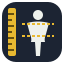
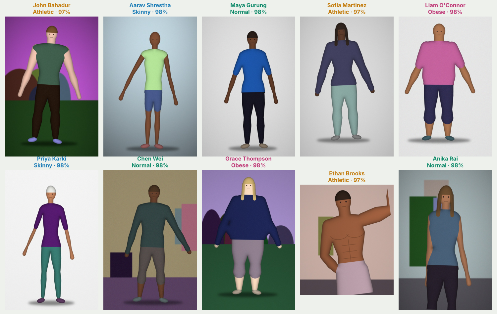
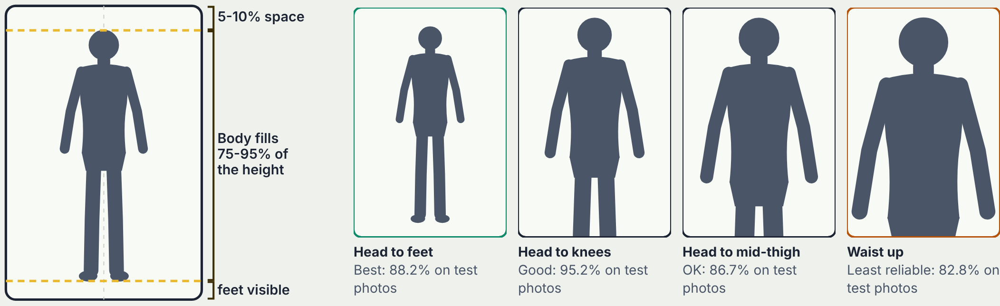
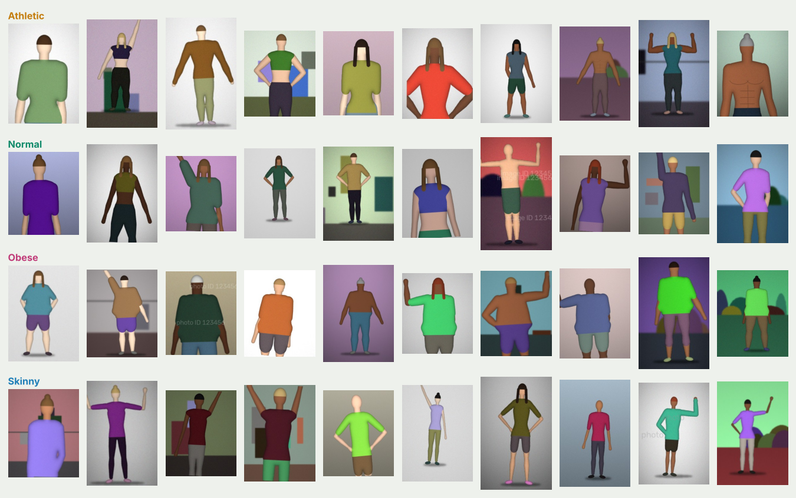
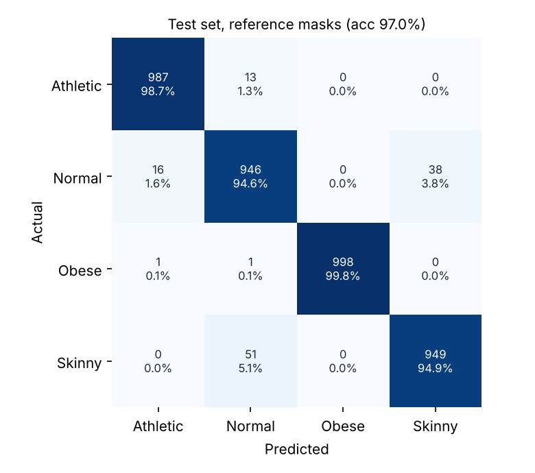
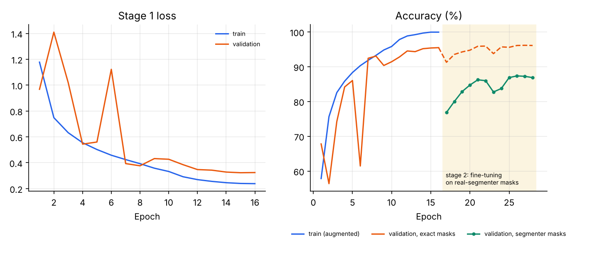

<p align="center">
  
</p>

<h1 align="center">[PhyVision](https://requiemdoomed.github.io/PhyVision/)</h1>

<p align="center">
  <strong>Human physique classification from a single photo, with a fitness guide for every result.</strong><br>
  Created and authored by <strong>Swayam Shakya</strong>
</p>

<p align="center">
  
  
  
  
  
  
</p>

---

PhyVision looks at a photo of one person, cuts the person out of the background, measures the shape of their silhouette and classifies the physique as **Athletic**, **Normal**, **Obese** or **Skinny**. Every result comes with class probabilities, the detected photo framing, a photo check against the photo guide, proportion estimates (shoulder-to-waist, waist-to-hip, shown when both arms are held away from the body) and a **fitness guide** for that body type: goals, a sample training week, key exercises, nutrition advice, a sample day of eating, recovery habits and safety notes.

<p align="center">
  
</p>

## Highlights

- **16,000-image AI-generated dataset** (2,000 train, 1,000 validation, 1,000 test per class) with exact labels and pixel-perfect masks, covering many poses (arms down or out, hands on hips, hand in pocket, bicep flex, raised arm), slight body turns, and photo framings from head-to-feet down to waist-up.
- **PhyNet**: a ResNet-18 silhouette branch fused with a shape-profile MLP, plus a framing head that estimates how much of the body is in the photo. Trained end to end in two stages.
- **97.00% test accuracy** on 4,000 held-out people with exact masks. **88.00%** end to end when the person is cut out of the raw photo by rembg, and **81.33%** with the fully offline GrabCut segmenter (600 test photos each).
- **Built for real photos**: stage 1 corrupts training masks on purpose; stage 2 fine-tunes on about 8,000 masks cut out of the training photos by rembg and GrabCut, so the model knows what background removers get wrong.
- **Realistic body classes**: body widths are calibrated against adult anthropometric ratios, so a real lean person is not mistaken for "Normal" because the synthetic "Skinny" class was a caricature.
- **Photo guide and photo check**: a page explaining exactly how to take the photo (aspect ratio, framing, pose, clothing, background, light), and an automatic eight-point check on every upload.
- **Three ways to find the person**: transparent PNG alpha, [rembg](https://github.com/danielgatis/rembg) human segmentation (default), or OpenCV GrabCut (fully offline fallback).
- **Fitness guides** for all four classes, written to be practical and safe.
- **Web interface**: `index.html` is the control center for the server, model, dataset, notebook and files, with an analyzer, photo guide and guide library. Responsive, keyboard accessible, light and dark themes.
- **Works offline**: the HTML pages open straight from disk with demo results, metrics and guides; uploads need the local server.
- **Training-image integrity check**: MD5 fingerprints flag any upload that is identical to a training image (kept from v4.0).
- **Private by design**: photos are processed on your own computer.

## Quick start

Requires Python 3.10 or newer. The trained model and the full dataset ship with the repository, so you do not need to train anything.

```bash
git clone https://github.com/<your-username>/PhyVision.git
cd PhyVision

python -m venv .venv
# Windows: .venv\Scripts\activate     macOS / Linux: source .venv/bin/activate

pip install -r requirements.txt

python app.py
```

Your browser opens the control center at <http://127.0.0.1:5000>. The first photo you analyze downloads rembg's human-segmentation model (about 170 MB) once; after that everything runs offline. If rembg cannot be installed or downloaded, PhyVision uses OpenCV GrabCut automatically. Use `python app.py --port 8000` to change the port or `--no-browser` to stop it opening a tab.

Command line instead of the browser:

```bash
python scripts/predict.py web/demo/john_bahadur.jpg
python scripts/predict.py path/to/your_photo.jpg --seg rembg
```

Notebook: open [`notebooks/PhyVision.ipynb`](notebooks/PhyVision.ipynb) in Jupyter, VS Code or Google Colab (upload `PhyVision.zip` to the Colab session first).

## Taking the photo

PhyVision reads the outline of the body, so the photo matters as much as the model. The full guide with diagrams is `web/photo-guide.html` (linked from every page).

<p align="center"></p>

| Setting | Best | Accepted | Avoid |
|---|---|---|---|
| Orientation and aspect ratio (width : height) | Portrait 2:3 (0.67) or 3:4 (0.75) | 0.60 to 0.95 | Square or landscape |
| Image size | 1000 px tall or more | 400 px tall or more | Under 300 px |
| Person's height in the photo | 80 to 90% of the photo height | 70 to 95% | Under 50% |
| Space above the head | 5 to 10% | Any, if the head is not cut | Head cut off |
| How much of the body | Head to feet | Head to knees or mid-thigh | Waist up only |
| Position | Centred, arms inside the frame | Slightly off centre | Body touching the edge |
| Camera | 2 to 3 m away at waist or chest height, phone upright | Rear camera with a timer or a friend | Close-up or mirror selfies |

**Pose:** stand straight facing the camera, feet hip-width apart, arms 10 to 20 cm away from your sides. Hands on hips, a hand in a pocket, a bicep flex and one raised arm are also supported. Side, back, sitting, lying and bending poses are not.
**Clothing:** fitted sportswear, T-shirt, leggings or shorts, or shirtless. No coats, hoodies, loose dresses or bags.
**Background and light:** a plain, evenly lit wall; no other people or mirrors; light from the front, not a bright window behind you. No filters or body-shaping edits.

Accuracy by framing on the held-out test photos (person cut out by rembg):

| Framing | Accuracy, rembg (test photos) |
|---|---:|
| Head to feet | 88.2% (305) |
| Head to knees | 95.2% (83) |
| Head to mid-thigh | 86.7% (113) |
| Waist up | 82.8% (99) |

Every result includes a **photo check**: resolution, orientation, one person, background separation, person size, head in frame, centring and framing, each marked as passing, could be better, or a problem.

## Using the app

| Page | What it does |
|---|---|
| `index.html`: **Control center** | Server, model and segmentation status; the photo rules; model performance with confusion matrices and training curves; dataset counts and samples; every project file with its purpose; run instructions |
| `web/app.html`: **Analyze a photo** | Upload (or drag and drop) a photo or pick a demo person. See the class, confidence, probabilities, detected framing, photo check, the detected person, the silhouette the model sees, proportion estimates and the matching fitness guide |
| `web/photo-guide.html`: **Photo guide** | How to take a photo PhyVision can read, with diagrams and accuracy per framing |
| `web/guides.html`: **Fitness guides** | All four guides, linkable as `guides.html#skinny`, `#normal`, `#athletic`, `#obese` |

### Demo people

Fictional, computer-rendered people are included for testing. They are not photos of real individuals.

| Name | Photo type | Image |
|---|---|---|
| John Bahadur | Full body, ideal photo | `web/demo/john_bahadur.jpg` |
| Aarav Shrestha | Full body, ideal photo | `web/demo/aarav_shrestha.jpg` |
| Maya Gurung | Full body, ideal photo | `web/demo/maya_gurung.jpg` |
| Sofia Martinez | Full body, ideal photo | `web/demo/sofia_martinez.jpg` |
| Liam O'Connor | Full body, ideal photo | `web/demo/liam_oconnor.jpg` |
| Priya Karki | Full body, ideal photo | `web/demo/priya_karki.jpg` |
| Chen Wei | Full body, ideal photo | `web/demo/chen_wei.jpg` |
| Grace Thompson | Full body, ideal photo | `web/demo/grace_thompson.jpg` |
| Ethan Brooks | Cropped at mid-thigh, bicep flex | `web/demo/ethan_brooks.jpg` |
| Anika Rai | Cropped at the knees | `web/demo/anika_rai.jpg` |

## How it works

```
photo ─► find the person ─► clean silhouette ─► 128×128 frame ─┐            ┌─► class + probabilities ─► fitness guide
          (alpha / rembg /     (largest body,                   ├─► PhyNet ─┤
           GrabCut)            fill holes)    shape profile ────┘            └─► framing ─► photo check
                                              (width at 48 heights + 4 shape stats)
```

1. **Find the person.** A transparent PNG is used as is. Otherwise PhyVision uses rembg's `u2net_human_seg` model, falling back to OpenCV GrabCut. Photos under 600 px tall are first enlarged (up to 4×) so the cut-out edges are smoother.
2. **Clean the silhouette.** Keep the person and attached limbs, drop stray blobs, fill holes.
3. **Normalise.** Crop to the body and scale it to 94% of a 128 × 128 frame, keeping its aspect ratio.
4. **Measure.** The width of the body (all pixels, and the central torso or leg run) is measured at 48 heights, plus aspect ratio, fill, relative area and convex-hull solidity: 100 numbers.
5. **Classify.** PhyNet combines a ResNet-18 (single-channel, 512 features) reading the silhouette with an MLP (64 features) reading the profile. A class head gives 4 probabilities; a framing head estimates the fraction of the body in the photo. The silhouette and its mirror image are averaged at test time.

Classifying the outline rather than raw pixels makes the decision independent of face, skin tone and clothing colour, and lets a model trained on rendered people transfer to photos. Learning the framing tells the model how to read a photo cropped at the knees or thighs, where the torso fills more of the outline.

## Dataset

Real, consented, openly licensed photos of thousands of people per body type are not available to redistribute, and commercial stock libraries do not allow it, so PhyVision **generates** its people. [`src/phyvision/synth.py`](src/phyvision/synth.py) builds each body from anatomical widths (shoulders, chest, waist, belly, hips, neck, arms, legs) drawn from per-class distributions with overlap at the borders, then randomises sex, 12 skin tones, hair, clothing type and colour, loose fit, arm pose, body turn, photo framing, aspect ratio, background scene (including plain stock-photo backdrops), faint watermarks, lighting, camera roll, blur and noise. Train, validation and test people use disjoint random seeds.

| Split | Athletic | Normal | Obese | Skinny | Total |
|---|---:|---:|---:|---:|---:|
| Train | 2,000 | 2,000 | 2,000 | 2,000 | 8,000 |
| Validation | 1,000 | 1,000 | 1,000 | 1,000 | 4,000 |
| Test | 1,000 | 1,000 | 1,000 | 1,000 | 4,000 |

Framings across all splits: head to feet 8,112 (51%), head to knees 2,376 (15%), head to mid-thigh 3,173 (20%), waist up 2,339 (15%).

<p align="center"></p>

Alongside each image is its exact mask (`*_mask.png`), and `metadata.csv` records sex, framing, visible fraction, arm poses, turn, clothing, background, image size and the generator's body ratios. For stage 2, all 8,000 training photos and 800 validation photos also have a mask cut out by rembg or GrabCut (`*_seg-rembg.png`, `*_seg-grabcut.png`). No test image was ever segmented for training. Details: [`docs/DATASET_CARD.md`](docs/DATASET_CARD.md).

## Results

Held-out test split, which was never used for training or model selection.

| Evaluation | Test images | Accuracy | Macro F1 |
|---|---:|---:|---:|
| Exact masks (classifier only) | 4,000 | **97.00%** | 0.970 |
| End to end, rembg segmentation | 600 | **88.00%** | 0.880 |
| End to end, GrabCut segmentation (offline) | 600 | **81.33%** | 0.813 |

Per class:

| Class | Precision | Recall | F1 | F1 with rembg | F1 with GrabCut |
|---|---:|---:|---:|---:|---:|
| Athletic | 0.983 | 0.987 | 0.985 | 0.885 | 0.822 |
| Normal | 0.936 | 0.946 | 0.941 | 0.825 | 0.724 |
| Obese | 1.000 | 0.998 | 0.999 | 0.944 | 0.913 |
| Skinny | 0.961 | 0.949 | 0.955 | 0.868 | 0.794 |

Framing estimate: mean absolute error 0.004 (fraction of body height) on the test set.

<p align="center">
  
  
  
</p>
<p align="center"></p>

These numbers are measured on rendered people. Accuracy on real photographs has not been measured on a labelled set and will be lower; it depends mainly on following the photo guide and on how cleanly the person is cut out. See the [model card](docs/MODEL_CARD.md).

## Limitations and responsible use

- **Not a medical device.** PhyVision estimates shape from a 2-D outline. It does not measure body fat, weight, muscle or health. The fitness guides are general education; talk to a doctor or registered dietitian before major changes, especially with a medical condition, pregnancy, injury, or if you are under 18.
- **Synthetic training data.** The model has only seen rendered people. Expect lower accuracy on real photos, especially with loose clothing, side-on poses, cluttered backgrounds, very small images or waist-up crops. The photo check flags the common problems.
- **Four coarse classes.** Real bodies sit on a continuum, and borderline results are flagged as such.
- **Respect people.** Only analyze photos of yourself or of people who have agreed. Do not use PhyVision to judge, rank or shame anyone.

## AI assistance

Claude, an AI model by Anthropic, was used as a learning aid for two parts of this project: building the synthetic dataset generator (`src/phyvision/synth.py`, `scripts/generate_dataset.py`) and the model-training pipeline (`src/phyvision/train.py`, `src/phyvision/finetune.py`, `scripts/build_segmenter_masks.py`, `scripts/average_checkpoints.py`). The dataset images themselves are computer-generated; no photographs of real people were used for training.

## License

Code: [MIT](LICENSE) © 2026 Swayam Shakya. Generated dataset images and masks: CC BY 4.0, attribution "PhyVision dataset by Swayam Shakya". 

## Acknowledgements

He et al., *Deep Residual Learning for Image Recognition* (CVPR 2016); Loshchilov and Hutter, *Decoupled Weight Decay Regularization* (ICLR 2019); [rembg](https://github.com/danielgatis/rembg); OpenCV; PyTorch; the body-shape classification work of Cameron Trotter (Newcastle University) and the Mahsa33 and farazBhatti projects that inspired v4.0.
